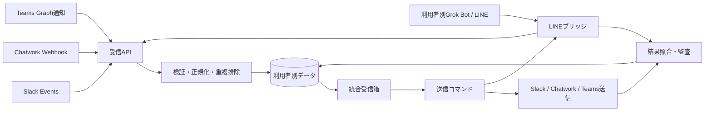

# 個人別・4サービス統合受信箱の初期設計案

作成日: 2026-10-18

> **実装状況（2026-10-19）**: この文書は4サービス・共有サーバーを前提にした初期設計の記録。現在はGmailとMessengerを追加し、作成者がAPI資格情報を預からない配布を本人所有インスタンスへ変更した。現行の方針は [資格情報の保管と配布](credential-custody.md)、[Gmail・Messenger連携](gmail-messenger.md)、[README](../README.md) を参照。以下の「連携先のAPI資格情報はサーバー側」など共有サーバー前提の記述は現行配布方針として採用しない。

## 目的と完成条件

各利用者が自分の個人LINE、Slack、Chatwork、Teamsの要対応メッセージを一つの画面で確認し、そこから返信する。個人LINEの読み取り・返信は依頼者のGrok Bot環境で再現済みとする。未検証なのはGrok Botと受信箱の双方向連携である。

外部サービスを含むためエラーゼロは保証できない。完成条件は「誤宛先・重複送信・通知の黙った欠落を防ぎ、障害を検知して復旧できること」とする。

- 別利用者の会話・認証情報・送信指示を取得できない。
- 宛先が確定できない返信は送らない。
- 送信結果が不明なら自動再送せず「要確認」で止める。
- 接続切れ、権限切れ、同期遅延をサービスごとに表示する。
- 再配信された受信イベントを重複登録しない。
- 「送信済み」は送信元で成功を確認してから表示する。

## 対象と前提

初期対象はDMと本人へのメンション。全チャンネル投稿は既定で取り込まない。受信箱の「要対応」はアプリ固有の状態で、元サービスの未読状態と同一視しない。各人は自分のGrok Botユーザーアカウントを使う。同一アカウント内の別Botはログインを共有するため、利用者分離には使わない。Teamsは職場・学校アカウントを対象とする。

## 構成

受信APIは署名・認証を検証し、イベント保存後すぐ応答する。正規化と画面更新は非同期に処理する。取得可能な履歴と定期照合し、Webhook欠落を補う。Teamsは本番で使えるチャット単位の変更通知を基本とし、新しいチャットの発見・購読更新・期限更新を別処理にする。

LINEブリッジはGrok Botが呼ぶ専用HTTPS/MCPツールとして設ける。操作は「新着を登録」「本人の未処理送信を一件取得」「送信結果を報告」に絞る。各呼び出しで利用者を認証し、他人のデータを渡さない。Grok Botの定期ルーチンは公式資料で最短5分間隔なので、LINEに1分以内の通知・返信を保証する設計にはしない。短い遅延が必須なら別の起動手段を実証する。

## データと認証

テーブルの関係と制約は [ER図・データモデル](data-model.md) に示す。

連携は `user_id + provider + provider_account_id`、会話は `user_id + provider + external_conversation_id` で識別する。Slack・Chatwork・Teamsの受信は外部メッセージIDを重複排除キーにする。LINE画面から安定IDを取れない場合は会話、送信者、本文、時刻で観測指紋を作り、曖昧な重複候補は照合待ちにする。指紋を絶対的なIDとはみなさない。

連携先のAPI資格情報はサーバー側で暗号化する。受信箱のセッション・ブリッジ鍵はハッシュで保存する。LINEのログイン情報は受信箱へコピーせず、各人のGrok Bot環境に残す。本文の保存期間と削除機能を設け、管理者の通常画面では個人の本文を読めないようにする。

## 実装基盤と配布

Web画面はReact、APIはTypeScriptのHTTPサーバー、永続データはPostgreSQL、イベント処理と送信はジョブキューに分ける。DBには利用者・連携・会話・メッセージ・送信コマンド・監査イベントを持つ。受信イベント保存と重複排除、送信コマンド作成と状態変更はそれぞれDBトランザクションで行う。送信コマンドの取得は期限付きリースと原子的な状態変更で一件だけに制限する。期限切れでも外部送信に入った可能性があれば自動的に再配布しない。

利用開始時は各人が受信箱に登録し、自分のSlack・Chatwork・Teamsを認可する。LINEはBotテンプレートを各人のGrok Botアカウントに追加し、その人が自分でChrome版LINEへログインする。受信箱とのペアリングは期限付きの一回限りコードで行い、Botに本人専用・機能限定の接続権限だけを付与する。Botテンプレートには他人の認証情報や会話内容を入れない。

## 送信手順

状態は `下書き → 送信待ち → 実行中 → 送信済み`、または `失敗／要確認`。画面の送信操作ごとに一意の `client_request_id` を発行し、連打や通信再試行で送信コマンドを増やさない。送信対象の利用者、サービス、アカウント、会話ID、表示名、本文、本文ハッシュを固定する。

API経由の送信は応答と送信元メッセージIDを記録する。応答が不明なら送信元を照合するまで再送しない。LINEはGrok Botが送信直前にログイン中の本人と会話の相手を再確認する。同名相手など、確証がなければ止める。クリック後に同じ会話で本文を確認してから「送信済み」とする。クリック後の結果が不明なら「要確認」に移し、自動で再クリックしない。LINEの画面操作には送信元側の冪等キーがないため、厳密な一回送信は保証できない。

LINEの新着取得で会話を開くと既読状態に影響する可能性がある。実機で確認し、影響するなら一覧プレビューのみを先に取得するか、利用者が開いた時点で全文取得する。

## 画面

左にサービス・要対応・送信失敗の絞り込み、中央に会話一覧、右に選択会話と返信欄を置く。狭い画面では一覧と会話を順に表示する。各会話にサービス名、相手、最終受信時刻、最終同期時刻、送信状態を文字でも示す。接続障害は該当サービスだけに示し、他の操作を妨げない。エラーには原因と次の操作を添える。

[UI Design Dictionary](https://ui-design-dictionary.pages.dev/)のサイドバーナビと通知パネルを参照した。継続的な処理に使うため通知パネルではなく常設一覧を採用する。状態表示と障害案内は[デジタル庁デザインシステム](https://design.digital.go.jp/dads/)の[チップラベル](https://design.digital.go.jp/dads/components/)と[ノティフィケーションバナー](https://design.digital.go.jp/dads/components/notification-banner/)を参照する。キーボード操作と色以外の状態表示を必須にする。

## 画面の操作契約

| 利用者の仕事 | 開始条件 | 完了の表示 | 失敗時の扱い |
|---|---|---|---|
| 新着を確認 | 一つ以上の連携が有効 | 会話一覧と各連携の最終同期時刻を表示 | 一部停止でも取得済みの会話を見せ、停止元を明示 |
| 返信する | 会話と宛先が確定 | 送信元で確認後に「送信済み」 | 「要確認」を会話内と専用一覧の両方に残す |
| 対応済みにする | 対象会話を選択 | 要対応一覧から移動 | 元に戻せる |
| 連携を直す | 権限切れ・ログイン切れ | 再接続後に同期時刻更新 | 再接続できない理由を保持 |

初回で連携がない場合はサービス接続へ案内する。読み込み中はサービス別の進捗を示す。部分的な取得では表示済みの会話を隠さない。同期時刻がしきい値を超えた会話には「古い可能性」を付け、返信前に再照合する。権限不足のサービスは送信ボタンを無効にして理由と復旧操作を示す。送信直前の本文と宛先を同じ視界に置き、タブ切替中の誤送信を避ける。送信後は入力欄を消さず、送信済みが確定してから消す。要確認時は本文を編集・再送する操作を直ちには出さず、先に送信元の確認へ誘導する。

## 代表的な障害時の動き

| 事象 | システムの動き | 利用者への表示 |
|---|---|---|
| LINEログイン切れ | LINE観測と送信を停止し、送信待ちは保留 | 「LINEの再ログインが必要」 |
| Grok Botが実行されない | 最終同期時刻から停止を検知 | 「LINEの同期が遅れています」 |
| 宛先が同名で判別できない | 送信しない | 「相手を確認してください」 |
| 送信後の画面確認に失敗 | 再送せず、照合待ち | 「送信結果を確認してください」 |
| Webhook再送 | 一意キーで二重登録を抑止 | 表示を増やさない |
| API権限切れ | 該当連携のみ停止 | 「このサービスを再接続」 |
| DB・キュー障害 | 受信の成功応答を返さず再送を待つ。履歴照合も実施 | 「同期に障害があります」 |

## 検証

- Webhook再送、順序逆転、欠落、期限切れ、API制限、Grok Bot停止、LINEログイン切れを疑似再現する。
- LINEの同名相手、送信直後のタイムアウト、画面変更、既読への影響を実機で確認する。
- 複数人のテストで、他人の会話や送信コマンドを取得できないことを確認する。
- 失敗時に通知が消えず、送信状態を利用者が判断できることを確認する。

## 段階的な受け入れ条件

1. 依頼者のGrok Botで、LINEから受信箱への登録と、受信箱から指定したLINE会話への返信を一往復させる。送信結果が不明になるテストも行う。
2. Slack・Chatwork・Teamsを加え、各サービスの再送・権限切れ・接続切れで通知や返信が消えないことを確認する。
3. 別ユーザーのGrok Botアカウントで同じ設定を行い、互いの会話・送信指示・認証情報が交差しないことを確認する。
4. 数人で試し、LINEの同期遅延と既読への影響を実測する。許容値を満たした場合に配布を広げる。

## 公開前に確定すること

1. LINE内の読み取り・返信の再現手順と、検証済みの一時HTTPS MCPから実際の受信箱MCPへ切り替える手順。
2. LINEの許容遅延。5〜10分でよいか、1分以内が必要か。
3. 想定利用者数。初期案は共通Webアプリ内で利用者ごとにデータを分離し、Grok Botは各人のアカウントに配布する。
4. Teamsの所属組織で必要なアプリ権限を取得できるか。
5. LINE本文をサーバーに保存してよいか。
6. 各利用者がGrok Botの利用資格と運用費を持てるか。

## 参照仕様

- [Grok Botのログイン共有](https://docs.x.ai/grok-bot/approvals-security-and-privacy)、[ルーチン](https://docs.x.ai/grok-bot/skills-routines-and-automations)、[カスタムMCP](https://docs.x.ai/grok-bot/team-bots)
- [Slack Events API](https://docs.slack.dev/apis/events-api/)、[Slack送信](https://docs.slack.dev/reference/methods/chat.postMessage/)
- [Chatwork Webhook](https://developer.chatwork.com/docs/webhook)、[Chatwork OAuth](https://developer.chatwork.com/docs/oauth)
- [Teams変更通知](https://learn.microsoft.com/en-us/graph/teams-changenotifications-chatmessage)、[Teams送信](https://learn.microsoft.com/en-us/graph/api/chat-post-messages?view=graph-rest-1.0)
- [Chrome版LINE](https://help.line.me/line/smartphone?contentId=50001182&lang=ja)
