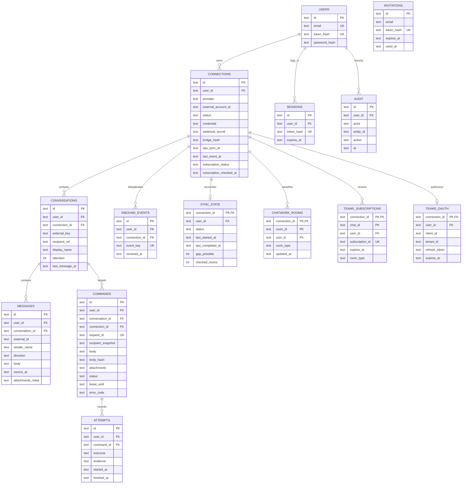

# 統合受信箱 ER図（実装版）

SQLite の実装スキーマは [`src/store.mjs`](../src/store.mjs) にある。次の図は、実際に作成する14テーブルと関係を示す。

- `user_id` と親IDの複合外部キーで、利用者をまたぐ参照をDB上で拒否する。`COMMANDS` は会話と連携先の組合せも複合外部キーで固定する。
- `CONNECTIONS` の `credential`、`webhook_secret`、`MESSAGES` と `COMMANDS` の `body`、添付ファイル本体と表示メタデータ、`TEAMS_OAUTH.refresh_token` は AES-256-GCM 暗号文。ユーザートークン・LINEブリッジ鍵・送信リース鍵はハッシュのみ保持する。送信結果が確定またはリース切れになると、`COMMANDS.attachments` を消す。
- `INBOUND_EVENTS(connection_id,event_key)`、`MESSAGES(conversation_id,external_id)`、`COMMANDS(user_id,request_id)` が再配信・操作再試行の重複を抑える。
- `COMMANDS.status` は `queued / leased / executing / sent / failed / uncertain`。LINEは `executing` の後、外部画面で確認された時だけ `sent`。リース切れは `uncertain` にし、自動再送しない。
- LINE・Gmail・Messengerブリッジは `CONNECTIONS.bridge_hash` で1連携に1つの現行鍵を持つ。鍵を再発行すると古い鍵は無効になる。GmailのOAuth更新トークンは本人端末のエージェント設定に置き、このDBには保存しない。

構想段階の独立した `LINE_BRIDGE_BINDINGS` は実装では `CONNECTIONS` に統合した。送信コマンドの履歴は `ATTEMPTS` に残す。`SYNC_STATE` に履歴照合の成功・失敗と取りこぼし可能性を記録し、`CHATWORK_ROOMS` でDM判定、`TEAMS_SUBSCRIPTIONS` で購読期限を管理する。公開運用には本文保持期間と削除機能が必要。
